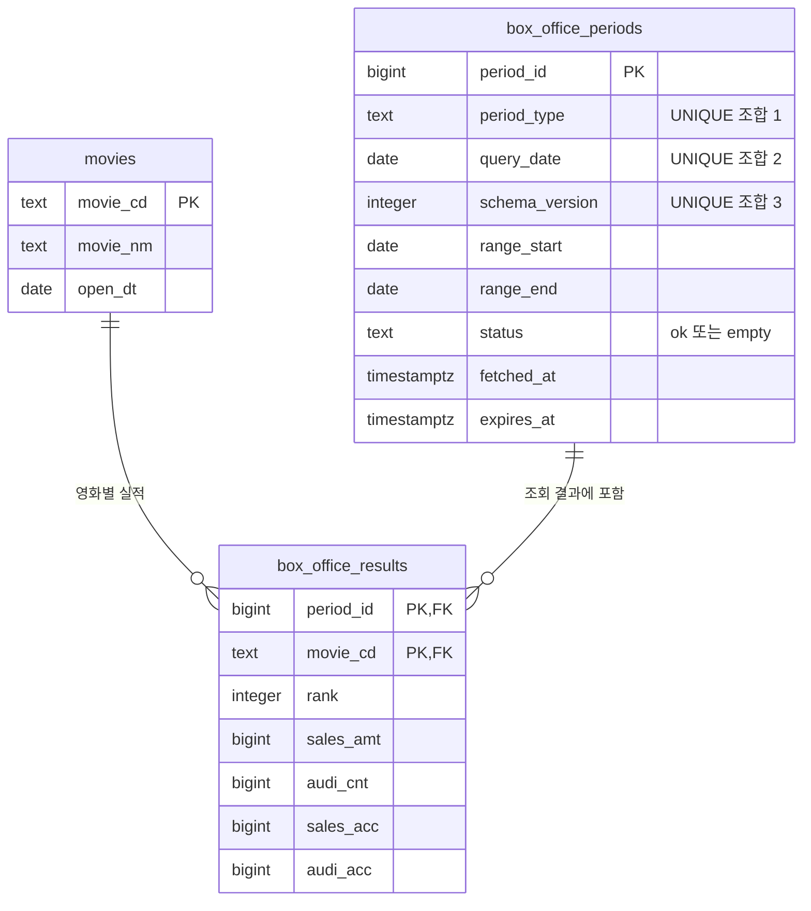

# 박스오피스 데이터 테이블 설계

- 상태: 설계 초안
- 작성일: 2026-10-24
- 기준: [ARCHITECTURE.md](./ARCHITECTURE.md), [PRD.md](./PRD.md)

## 1. 저장할 데이터

| 분류 | 저장 항목 | KOBIS 필드 또는 용도 |
| --- | --- | --- |
| 영화 정보 | 영화 코드, 이름, 개봉일 | `movieCd`, `movieNm`, `openDt` |
| 조회 기간 | 기간 유형, 조회 기준일 | `daily / weekly / weekend`, API 요청의 기준 날짜 |
| 조회 기간 | 실제 집계 시작일·종료일 | 일간은 기준일과 같음. 주간·주말은 응답의 `showRange`로 확인 |
| 기간별 영화 실적 | 순위, 기간 매출, 기간 관객수 | `rank`, `salesAmt`, `audiCnt` |
| 기간별 영화 실적 | 누적 매출, 누적 관객수 | `salesAcc`, `audiAcc`. 해당 응답 시점의 누적값 |
| 캐시 관리 | 정상 결과 상태, 수집 시각, 만료 시각, 스키마 버전 | `ok / empty`, `fetched_at`, `expires_at`, `schema_version` |

KOBIS는 숫자도 문자열로 반환한다. 서버에서 형식과 범위를 검증한 뒤 숫자로 저장한다. 영화 코드는 계산 대상이 아닌 식별자이므로 문자열로 유지한다. 개봉일이 없으면 `NULL`을 저장한다.

## 2. 하나의 표로 저장할 때의 문제

한 행이 ‘특정 조회 기간에 포함된 영화 한 편’인 단일 표를 가정한다.

```text
box_office_flat(
  period_type, query_date, schema_version,
  range_start, range_end, status, fetched_at, expires_at,
  movie_cd, movie_nm, open_dt,
  rank, sales_amt, audi_cnt, sales_acc, audi_acc
)
```

자연스러운 행 식별자는 `(period_type, query_date, schema_version, movie_cd)`다. 그러나 영화명·개봉일은 `movie_cd`만으로 결정되고, 집계 범위·캐시 메타데이터는 조회 기간만으로 결정되므로 같은 정보가 반복된다.

| 이상 현상 | 구체적인 문제 |
| --- | --- |
| 삽입 이상 | 아직 순위 실적이 없는 영화 정보를 따로 등록하기 어렵다. 정상 빈 응답도 영화 행이 없으므로 기록할 수 없고, 억지로 넣으려면 영화 코드가 비어 있는 예외 행이 필요하다. |
| 수정 이상 | 영화명이나 개봉일을 정정할 때 여러 날짜의 모든 행을 수정해야 한다. 일부만 고치면 같은 영화가 서로 다른 이름·개봉일로 남는다. 한 조회 결과의 만료 시각도 영화 수만큼 반복 수정해야 한다. |
| 삭제 이상 | 영화의 마지막 실적 행을 지우면 영화 정보까지 사라진다. 특정 기간의 실적을 모두 지우면 그 기간이 ‘정상 빈 응답’인지 ‘미조회’인지 구분하는 조회·캐시 정보도 사라진다. |

## 3. 세 테이블로 분리

한 영화는 영화 정보 한 행, 한 조회 조건은 조회 기간 한 행, 그 기간에 포함된 각 영화는 실적 한 행으로 저장한다. 영화와 조회 기간의 다대다 관계를 실적 테이블이 연결한다.

이 설계는 ARCHITECTURE.md의 단일 `box_office_cache.payload` JSONB 저장 제안을 **세 테이블의 정규화된 저장 방식으로 구체화한 대안**이다. 구현 시 이 세 테이블을 캐시의 기준 저장소로 삼고, 같은 데이터의 JSONB 캐시 테이블을 별도로 중복 운영하지 않는다. 기존 아키텍처 문서 자체는 이번 작업에서 수정하지 않는다.

### 3.1 `movies` — 영화

| 열 | PostgreSQL 타입 | 키·제약 | 설명 |
| --- | --- | --- | --- |
| `movie_cd` | `text` | **PK**, 빈 문자열 금지 | KOBIS 영화 코드 |
| `movie_nm` | `text` | NOT NULL, 빈 문자열 금지 | 영화명. 동명 영화가 가능하므로 UNIQUE를 두지 않음 |
| `open_dt` | `date` | NULL 허용 | 개봉일 |

- FK는 없다.
- 영화명과 개봉일은 최신 검증 정보를 유지한다. 과거 응답 당시의 영화명 변경 이력은 MVP에서 보존하지 않는다.

### 3.2 `box_office_periods` — 조회 기간

| 열 | PostgreSQL 타입 | 키·제약 | 설명 |
| --- | --- | --- | --- |
| `period_id` | `bigint generated always as identity` | **PK** | 조회 결과 식별자 |
| `period_type` | `text` | NOT NULL, CHECK | `daily`, `weekly`, `weekend` 중 하나 |
| `query_date` | `date` | NOT NULL | 조회 기준일. 실제 집계 기간과 구분 |
| `schema_version` | `integer` | NOT NULL, 양수 | 캐시 형식 버전, 초기값 1 |
| `range_start` | `date` | NOT NULL | 실제 집계 시작일 |
| `range_end` | `date` | NOT NULL | 실제 집계 종료일 |
| `status` | `text` | NOT NULL, CHECK | 정상 결과 `ok` 또는 정상 빈 응답 `empty` |
| `fetched_at` | `timestamptz` | NOT NULL | 수집 시각, UTC 기준 |
| `expires_at` | `timestamptz` | NOT NULL | 캐시 만료 시각 |

- FK는 없다.
- **UNIQUE `(period_type, query_date, schema_version)`**로 같은 조회 조건의 중복을 막는다.
- `range_start <= range_end`, `expires_at > fetched_at`를 CHECK로 검증한다. 일간은 `range_start = range_end = query_date`여야 한다.
- 주간·주말은 서로 다른 유형이므로 같은 기준일이어도 별도 행이다. 서로 다른 기준일이 같은 실제 주간 범위를 반환하더라도 요청 조건별 캐시 행은 각각 유지한다.
- 외부 지역·영화 구분·반환 개수는 아키텍처대로 고정한다. 설정을 노출하면 고유 제약에도 해당 조건을 추가한다.

### 3.3 `box_office_results` — 기간별 영화 실적

| 열 | PostgreSQL 타입 | 키·제약 | 설명 |
| --- | --- | --- | --- |
| `period_id` | `bigint` | **PK 일부, FK** → `box_office_periods.period_id`, NOT NULL | 어떤 조회 결과인지 |
| `movie_cd` | `text` | **PK 일부, FK** → `movies.movie_cd`, NOT NULL | 어떤 영화인지 |
| `rank` | `integer` | NOT NULL, CHECK `> 0` | 해당 기간 순위 |
| `sales_amt` | `bigint` | NOT NULL, CHECK `>= 0` | 기간 매출, 원 |
| `audi_cnt` | `bigint` | NOT NULL, CHECK `>= 0` | 기간 관객수, 명 |
| `sales_acc` | `bigint` | NOT NULL, CHECK `>= 0` | 응답 기준 누적 매출, 원 |
| `audi_acc` | `bigint` | NOT NULL, CHECK `>= 0` | 응답 기준 누적 관객수, 명 |

- **복합 PK `(period_id, movie_cd)`**로 한 조회 결과에 같은 영화가 두 번 저장되지 않게 한다.
- `period_id` FK는 **ON DELETE CASCADE**: 오래된 조회 기간을 정리하면 그 기간의 실적도 함께 삭제한다.
- `movie_cd` FK는 **ON DELETE RESTRICT**: 실적에서 참조 중인 영화를 실수로 삭제하지 못하게 한다.
- 순위는 기간에 따라 달라지므로 PK로 사용하지 않는다. 동순위 가능성에 대비해 `(period_id, rank)`에 UNIQUE도 두지 않는다.
- 목록 정렬용 인덱스 `(period_id, rank)`, 영화별 이력 조회용 인덱스 `(movie_cd, period_id)`를 제안한다.

관계형 열에는 JSONB 내부 문자열 대신 `bigint`를 사용한다. PostgreSQL `bigint` 범위를 넘는 원본 값은 조용히 잘라 저장하지 않고 검증 오류로 처리한다. 서버의 계산은 JavaScript `bigint`, 브라우저로 전달하는 금액·인원은 10진 정수 문자열로 유지해 아키텍처의 정확도 원칙을 따른다.

### 3.4 저장과 캐시 일관성

1. KOBIS 응답 전체를 검증한 뒤 한 트랜잭션에서 영화 upsert, 조회 기간 upsert, 해당 기간의 기존 실적 삭제와 새 실적 삽입을 수행한다. 같은 기간을 동시에 갱신할 때는 기간 행 잠금 등으로 쓰기를 직렬화한다.
2. `ok` 기간은 실적이 1개 이상, `empty` 기간은 실적이 0개여야 한다. 이 규칙은 단순 FK·행 CHECK만으로 보장되지 않으므로 서버 전용 트랜잭션 함수에서 검사하고, 직접 쓰기 권한을 제한한다.
3. 정상 빈 응답은 기간 행만 저장하고 실적·가짜 영화 행을 만들지 않는다. TTL은 `ok` 1시간, `empty` 5분을 초깃값으로 적용한다.
4. 외부 실패는 `empty`로 저장하지 않고 기존 캐시와 만료 시각도 갱신하지 않는다. DB 저장 실패 시 트랜잭션 전체를 롤백하고 현재 요청에는 검증된 외부 결과를 반환한다.
5. 캐시 조회는 기간과 실적을 같은 SQL 문장의 스냅샷으로 읽는다. 서비스는 기간 행 부재·버전 불일치·만료를 미스로 판단한다. 조회 API는 만료된 결과를 최신 결과로 표시하지 않는다.
6. 세 테이블 모두 서버에서만 접근하며, Supabase 공개 역할의 직접 접근을 차단하고 아키텍처의 RLS·비밀키 정책을 적용한다.

## 4. ER 다이어그램



영화 한 편과 조회 기간 한 건은 각각 실적 0개 이상에 연결된다. 실적 한 행은 정확히 영화 한 편과 기간 한 건을 참조한다. 기간 쪽에서 0개를 허용하는 이유는 정상 빈 응답을 저장하기 위해서다.

## 5. 가상 데이터: 영화 2개 × 날짜 3일

아래 코드·이름·금액은 모두 설명용 가상 데이터다. 두 영화가 세 날짜 모두 API 순위 안에 포함되었다고 가정한다.

### 영화

| movie_cd | movie_nm | open_dt |
| --- | --- | --- |
| M001 | 별빛 항해 | 2026-10-21 |
| M002 | 가을의 편지 | 2026-10-21 |

### 조회 기간

모든 행의 `schema_version=1`, `status=ok`이다. 예시를 간결하게 하기 위해 시각 열은 아래 표에서 생략한다. 세 행 모두 `2026-10-24 00:10:00+00`에 수집하고 `2026-10-24 01:10:00+00`에 만료된다고 가정한다. JOIN 예시는 같은 날 00:30 UTC에 실행하여 세 날짜의 캐시가 모두 유효한 상황이다.

| period_id | period_type | query_date | range_start | range_end |
| --- | --- | --- | --- | --- |
| 101 | daily | 2026-10-21 | 2026-10-21 | 2026-10-21 |
| 102 | daily | 2026-10-22 | 2026-10-22 | 2026-10-22 |
| 103 | daily | 2026-10-23 | 2026-10-23 | 2026-10-23 |

### 기간별 실적

| period_id | movie_cd | rank | sales_amt | audi_cnt | sales_acc | audi_acc |
| --- | --- | --- | --- | --- | --- | --- |
| 101 | M001 | 1 | 100000000 | 10000 | 100000000 | 10000 |
| 101 | M002 | 2 | 80000000 | 8000 | 80000000 | 8000 |
| 102 | M001 | 2 | 90000000 | 9000 | 190000000 | 19000 |
| 102 | M002 | 1 | 120000000 | 12000 | 200000000 | 20000 |
| 103 | M001 | 1 | 150000000 | 15000 | 340000000 | 34000 |
| 103 | M002 | 2 | 110000000 | 11000 | 310000000 | 31000 |

## 6. JOIN으로 화면에 표시

### 6.1 특정 날짜 목록

다음 SQL의 `$1`은 조회 날짜, `$2`는 유형, `$3`은 서버가 사용하는 스키마 버전이다. 예시는 `2026-10-22`, `daily`, `1`을 바인딩한다. 문자열 보간 대신 쿼리 파라미터로 전달한다.

```sql
SELECT
    p.period_id, p.query_date, p.period_type,
    p.range_start, p.range_end, p.status,
    p.fetched_at, p.expires_at,
    r.rank, m.movie_cd, m.movie_nm, m.open_dt,
    r.sales_amt::text AS sales_amt,
    r.audi_cnt::text AS audi_cnt,
    r.sales_acc::text AS sales_acc,
    r.audi_acc::text AS audi_acc
FROM box_office_periods AS p
LEFT JOIN box_office_results AS r ON r.period_id = p.period_id
LEFT JOIN movies AS m ON m.movie_cd = r.movie_cd
WHERE p.query_date = $1::date
  AND p.period_type = $2
  AND p.schema_version = $3::integer
  AND p.expires_at > CURRENT_TIMESTAMP
ORDER BY r.rank ASC, m.movie_cd ASC;
```

`LEFT JOIN`은 정상 빈 기간도 유지한다. `empty` 기간이면 영화·실적 열이 NULL인 행을 서버에서 `items: []`로 변환한다. 기간 행이 없거나 만료되어 결과가 0행이면 캐시 미스다. 따라서 정상 빈 응답과 미조회·만료를 구분할 수 있다.

위 예시를 화면 형식으로 표시하면 다음과 같다. 매출 단위는 원, 관객수 단위는 명이다.

| 순위 | 영화명 | 개봉일 | 매출(원) | 관객수(명) | 누적 관객수(명) |
| --- | --- | --- | --- | --- | --- |
| 1 | 가을의 편지 | 2026-10-21 | 120,000,000 | 12,000 | 20,000 |
| 2 | 별빛 항해 | 2026-10-21 | 90,000,000 | 9,000 | 19,000 |

### 6.2 세 날짜의 영화별 합계

실제 서비스는 분석에 필요한 **모든 날짜의 유효한 기간 행을 확보한 뒤** 집계를 수행한다. 일부 날짜가 없거나 외부 요청에 실패하면 부분 집계를 반환하지 않는다. 아래는 세 날짜 모두 확보되었다는 전제의 SQL이며, 운영에서는 날짜·버전·Top 개수를 파라미터화한다.

```sql
SELECT
    m.movie_cd,
    m.movie_nm,
    SUM(r.sales_amt)::text AS period_sales,
    SUM(r.audi_cnt)::text AS period_audience
FROM box_office_periods AS p
JOIN box_office_results AS r ON r.period_id = p.period_id
JOIN movies AS m ON m.movie_cd = r.movie_cd
WHERE p.period_type = 'daily'
  AND p.query_date BETWEEN DATE '2026-10-21' AND DATE '2026-10-23'
  AND p.schema_version = 1
  AND p.status = 'ok'
  AND p.expires_at > CURRENT_TIMESTAMP
GROUP BY m.movie_cd, m.movie_nm
ORDER BY SUM(r.sales_amt) DESC,
         SUM(r.audi_cnt) DESC,
         m.movie_cd ASC
LIMIT 5;
```

| 영화 코드 | 영화명 | 3일 매출 합계(원) | 3일 관객수 합계(명) |
| --- | --- | --- | --- |
| M001 | 별빛 항해 | 340,000,000 | 34,000 |
| M002 | 가을의 편지 | 310,000,000 | 31,000 |

이 예시의 기간 매출은 650,000,000원, 기간 관객수는 65,000명, 일평균 매출은 216,666,667원이다. 누적 수치는 합산하지 않는다. 실제 7/14/30일 분석에도 같은 관계와 집계 규칙을 적용한다.

모든 실적은 API 반환 목록에 한정된다. 특정 영화의 실적 행이 없는 날짜는 순위 밖이거나 데이터가 없을 수 있으므로 그 영화의 매출 0으로 단정하지 않는다. 날짜 자체가 정상 빈 응답이면 차트 공백으로 표시하고 일평균 분모에서 제외한다.
